<h1 data-importer="text" align="left">Hey 👋 What's up?</h1>

###

My name is Claudevan, and I'm a software developer and tech enthusiast from Brazil 🇧🇷.

###

<h2 data-importer="text" align="left">About me</h2>

###

💻 Currently exploring AI, software development and system architecture 📚 Always learning something new and diving deep into how things work 🎯 Goals: Build innovative things, turn ideas into reality and become a better developer every day 🎲 Fun fact: I'm into sim racing and love pushing my limits on the track 🏎️

###

<h2 data-importer="text" align="left">Languages</h2>

###

  
  
  
  
  
  
  
  
  
  
  
  
  
  
  
  
  
  
  
  
  
  
  

###

<h2 data-importer="text" align="left">Technologies</h2>

###

  
  
  
  
  
  
  
  
  
  
  
  
  
  
  
  
  
  
  
  
  
  
  
  
  
  
  
  
  

###

<picture data-importer="pacman">
  <source media="(prefers-color-scheme: dark)" srcset="https://raw.githubusercontent.com/juniooo13/juniooo13/pacman-output/bomberman-contribution-graph-dark.svg?game=bomberman">
  <source media="(prefers-color-scheme: light)" srcset="https://raw.githubusercontent.com/juniooo13/juniooo13/pacman-output/bomberman-contribution-graph.svg?game=bomberman">
  
</picture>

###
